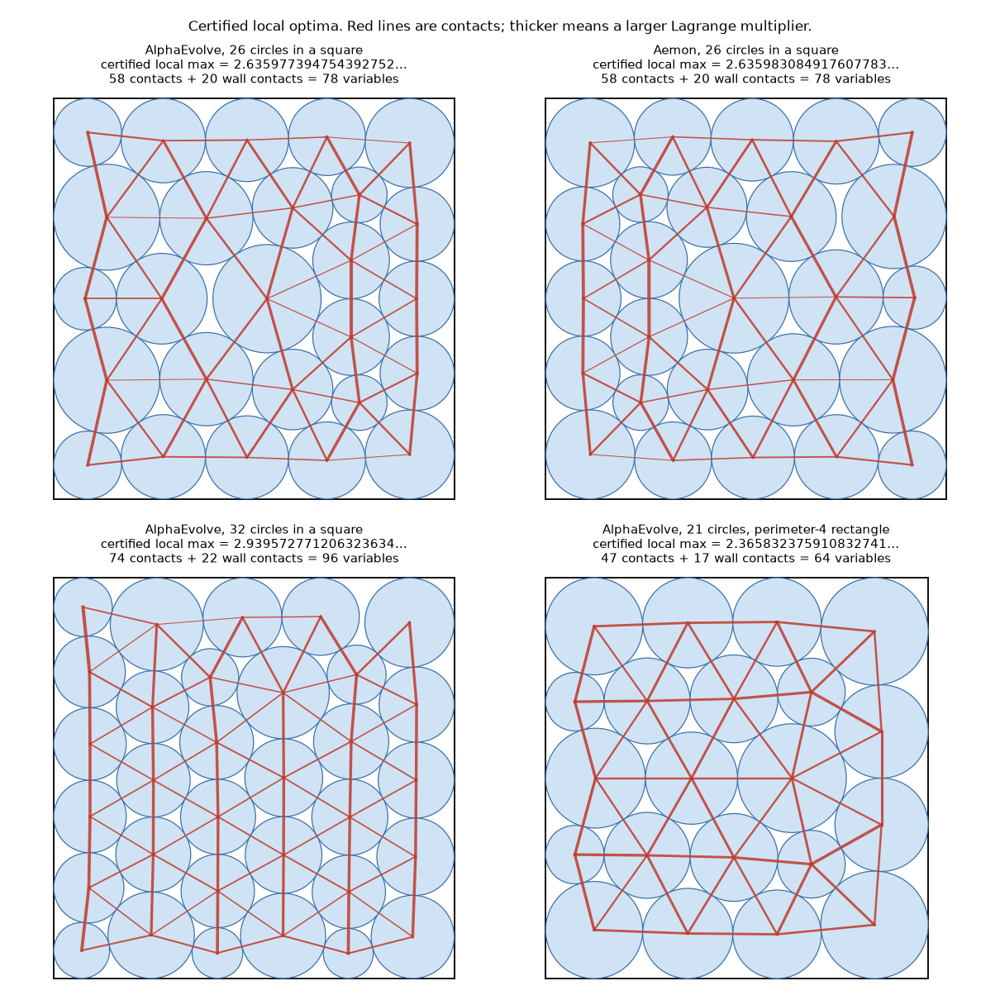

# Certificates for the public AlphaEvolve packing constructions

Generated by `packing-certify report`. Every number below is recomputed from the published decimals.

## 1. Published constructions, checked exactly

| Construction | Valid in exact arithmetic | Published sum of radii (exact) | Closest approach (pair / wall) |
|---|---|---|---|
| AlphaEvolve, 26 circles in a square | yes | 2.63586275641370 | 7.2e-09 / 7.9e-09 |
| Aemon, 26 circles in a square | yes | 2.63598308227816 | 1.6e-10 / 7.9e-11 |
| AlphaEvolve, 32 circles in a square | yes | 2.93794452620552 | 7.9e-09 / 6.3e-09 |
| AlphaEvolve, 21 circles, perimeter-4 rectangle | yes | 2.36583213341676 | 1.1e-08 / 0.0e+00 |

## 2. The local optimum each construction sits next to, certified

| Construction | Certified strict local maximum (enclosure, 30 digits) | Gain over published | Active / variables | Gap to next constraint | Smallest multiplier ≥ | Krawczyk margin |
|---|---|---|---|---|---|---|
| AlphaEvolve, 26 circles in a square | **2.635977394754392752218631205141…** | 1.15e-04 | 78 / 78 | 11.7 orders | 0.0098 | 4.7e-15 |
| Aemon, 26 circles in a square | **2.635983084917607783186569485443…** | 2.64e-09 | 78 / 78 | 12.1 orders | 0.0106 | 2.3e-18 |
| AlphaEvolve, 32 circles in a square | **2.939572771206323634996322323460…** | 1.63e-03 | 96 / 96 | 10.2 orders | 0.0176 | 3.7e-22 |
| AlphaEvolve, 21 circles, perimeter-4 rectangle | **2.365832375910832741572079722291…** | 2.42e-07 | 64 / 64 | 13.1 orders | 0.1144 | 1.4e-18 |

Each value is enclosed in an interval of width about 5e-39 (`results.json` has both ends).

## 3. What the published verifiers accept

Starting from each certified optimum, radii are grown for as long as the verifier still accepts.

| Construction | Verifier | Accepted | Reported sum | Above the certified maximum by | Valid in exact arithmetic | Violations (worst) |
|---|---|---|---|---|---|---|
| AlphaEvolve, 26 circles in a square | deepmind (strict float64) | yes | 2.6359773947543923 | -3.97e-16 | no | 11 (4.2e-17) |
| AlphaEvolve, 26 circles in a square | tolerance 1e-06 (OpenEvolve / CodeEvolve style) | yes | 2.6359903947413925 | +1.30e-05 | no | 78 (1.0e-06) |
| Aemon, 26 circles in a square | deepmind (strict float64) | yes | 2.6359830849176076 | -3.45e-16 | no | 15 (3.0e-17) |
| Aemon, 26 circles in a square | tolerance 1e-06 (OpenEvolve / CodeEvolve style) | yes | 2.6359960849046074 | +1.30e-05 | no | 78 (1.0e-06) |
| AlphaEvolve, 32 circles in a square | deepmind (strict float64) | yes | 2.9395727712063233 | -3.56e-16 | no | 22 (4.2e-17) |
| AlphaEvolve, 32 circles in a square | tolerance 1e-06 (OpenEvolve / CodeEvolve style) | yes | 2.9395887711903237 | +1.60e-05 | no | 96 (1.0e-06) |
| AlphaEvolve, 21 circles, perimeter-4 rectangle | deepmind (strict float64) | yes | 2.3658323759108324 | -2.75e-16 | no | 13 (4.2e-17) |

Verifier sources: deepmind: github.com/google-deepmind/alphaevolve_results @4226acb, mathematical_results.ipynb, B.12 verify_circles / B.13 verify_circles_disjoint; openevolve: github.com/algorithmicsuperintelligence/openevolve @15441c0, examples/circle_packing/evaluator.py lines 67 and 75; codeevolve: github.com/inter-co/science-codeevolve @c077959, problems/alphaevolve_math_problems/packing_problems/circle_packing_square/26/input/evaluate.py (TOL = 1e-6)
